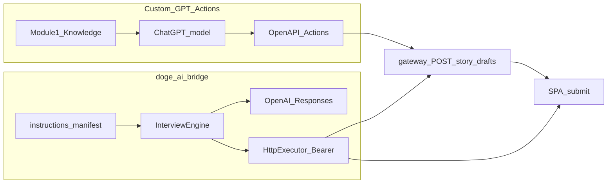

# 00 — Два канала: Custom GPT Actions vs doge-ai-bridge

**Зона:** [`architecture/`](./README.md)  
**As-of:** 2026-09-16  
**Related:** [REQ-47](../requirements/REQ-47-responses-api-https-bearer-bridge.md) · [aibridge 00-overview](../../../doge-ai-bridge/docs/architecture/runtime/00-overview.md)

---

## 1. Зачем два канала

Один **продуктовый** wire для user story: `POST /story-drafts` → `draft_id` → SPA submit.  
Два **транспорта**, которыми модель инициирует stash:

| Канал | Где живёт интервьюер | Кто исполняет HTTP к gateway |
|--------|----------------------|------------------------------|
| **A — Custom GPT Actions** | ChatGPT Custom GPT (Knowledge + Instructions) | Платформа OpenAI Actions по импортированному OpenAPI |
| **B — doge-ai-bridge** | Telegram/n8n → Python bridge → OpenAI **Responses** API | Приложение bridge (Bearer + allowlisted tool loop) |

Поведенческий SSOT текста интервью: [`GPT UI/instructions/`](../../instructions/) + active schema pack ([REQ-47 §1](../requirements/REQ-47-responses-api-https-bearer-bridge.md)).

Канал B **не** заменяет Actions ([REQ-47](../requirements/REQ-47-responses-api-https-bearer-bridge.md)).

---

## 2. Топология

**Bridge topology (as-built docs):** n8n (Telegram UI) ↔ `doge-ai-bridge` ↔ gateway ↔ SPA — см. [aibridge 00-overview §2](../../../doge-ai-bridge/docs/architecture/runtime/00-overview.md). Bridge **не** Telegram Bot API client.

---

## 3. Что общее

| Concern | Факт | Evidence |
|---------|------|----------|
| Operation | `operationId: postStoryDraftStash` · `POST` · `/story-drafts` | [`custom-gpt-story-intake-actions.openapi.yaml`](../custom-gpt-story-intake-actions.openapi.yaml) |
| Auth к gateway | HTTP Bearer = host `GPT_ACTIONS_BEARER_SECRET` | yaml header + `GptActionsBearer` |
| Success | HTTP **201** + `data.draft_id` (+ `trace_id`) — draft, не Story | orchestrator §5.2; yaml responses |
| Continuation | `{SPA_BASE}/#/story/submit?draft_id=` | [`api-orchestrator.md`](../../instructions/api-orchestrator.md) §5.2.B |
| Pack on wire | Root `schema_binding` required | OpenAPI 0.8.0 / SSR-02 |

---

## 4. Что различается

| Concern | Actions (A) | Bridge (B) |
|---------|-------------|------------|
| Tool execution | ChatGPT Actions runtime | App owns `function_call` → HTTPS ([REQ-47 §3](../requirements/REQ-47-responses-api-https-bearer-bridge.md)) |
| Instruction delivery | Knowledge upload + Configure Instructions | Env `DOGESTONIA_INSTRUCTIONS_*` + manifest — [05](./05-python-bridge-instruction-delivery.md) |
| OpenAPI import | GPT Configure → Actions | Path `DOGESTONIA_OPENAPI_PATH` (часто копия в `doge-ai-bridge/docs/openapi/`) |
| Confirm UI | Actions consequential + chat confirm | Dual confirm / n8n callbacks (см. aibridge `03-confirm-gateway.md`) |
| `origin.source` | de-facto `openai_gpt_action` (REQ-32 / orchestrator) | Config `DOGESTONIA_ORIGIN_SOURCE` (prefer distinct channel) |

---

## 5. Дальше по карте

- Слои Module-1 → [01](./01-module1-instruction-layers.md)  
- Packs → [02](./02-schema-packs-and-binding.md)  
- Init → stash → [03](./03-init-and-runtime-order.md)  
- Actions YAML → [04](./04-actions-openapi-wire.md)  
- Python/OpenAI → [05](./05-python-bridge-instruction-delivery.md)
