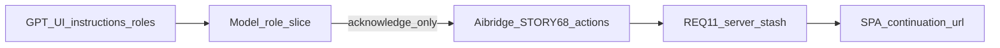

# REQ15 TG interviewer — roles UX residual (target tech-arch)

**Status:** Target · 2026-11-06T11:51:22Z  
**Method:** [`.cursor/rules/analysis.mdc`](../../../../.cursor/rules/analysis.mdc)  
**Stories:** [STORY-GPT-ROL-05](../../tasks/backlog-stories/req15-tg-interviewer-roles-ux/STORY-GPT-ROL-05-channel-interview-stage-proactivity.md) · [STORY-GPT-ROL-06](../../tasks/backlog-stories/req15-tg-interviewer-roles-ux/STORY-GPT-ROL-06-channel-interview-surface-readability.md)  
**Package INDEX:** [`../../tasks/backlog-stories/req15-tg-interviewer-roles-ux/INDEX.md`](../../tasks/backlog-stories/req15-tg-interviewer-roles-ux/INDEX.md)

## Context & inputs

| Input | Role |
|-------|------|
| ROL-05 / ROL-06 | Product AC for proactivity + handoff wording / TG surface |
| Peer [STORY-AIBRIDGE-68](../../../../doge-ai-bridge/docs/tasks/backlog-stories/req15-tg-channel-interviewer-ux/STORY-AIBRIDGE-68-channel-seam-send-actions-always.md) | Server mints continue/edit/Send actions |
| REQ-48 roles SSOT | [`instructions-roles/`](../../../instructions-roles/) — ROL-01…04 **Done**; do not reopen archive/export |
| Evidence | [triage](../../../../docs/analysis/req15-tg-interviewer-ux-gap-triage-2026-11-06.md) · [target UX](../../../../docs/analysis/req15-tg-interviewer-target-ux-2026-11-06.md) Goals 1/2/4/5/6 |

**Coexistence:** extends [`../req-48-role-oriented-instruction-line/00-overview.md`](../req-48-role-oriented-instruction-line/00-overview.md). This package = **residual channel UX** in instruction prose only.

## Trust boundaries

| Layer | Owns |
|-------|------|
| `instructions-roles` prose | Stage auto-advance policy; handoff **wording**; TG surface style |
| aibridge (STORY-68) | Mint continue / edit / Send confirm **actions** |
| REQ-11 Keep | HTTPS stash; `continuation_url` after success |
| SPA + identity | Login / OTP / citizen submit after user opens URL |

**Forbidden in roles prose:** model-owned `POST /story-drafts` / invent SPA URL or Bearer; bare «интерфейс» as sole handoff without naming in-chat actions or post-stash URL behavior.

## Target flow (logical)

1. Roles instruct **proactive** stage advance when citizen data enough (ROL-05 → [01](./01-stage-proactivity-handoff.md)).  
2. At non-seamless seams, model **acknowledges**; server exposes actions (peer 68).  
3. Send-ready → Send confirm → server stash → `continuation_url` in TG.  
4. Citizen-facing turns follow **air + light markers** (ROL-06 → [02](./02-surface-readability.md)).

**Edit order:** implement **05 then 06** (soft-parallel OK if handoff paragraphs not co-edited).

## Locked touch set (implement later)

| File | ROL-05 | ROL-06 |
|------|--------|--------|
| `instructions-roles/core.md` | primary (constitution + handoff contract; keep stash bans) | primary (style block) |
| `instructions-roles/interviewer.md` | primary (auto-advance dialogue) | primary (scannable citizen replies) |
| `checker.md` / `normalizer.md` | handoff sentences only if needed | only if they emit long walls |
| Other roles / packs / archive | OOS | OOS |

## Verify surfaces

- Grep: stash/SPA invent strings still forbidden (ROL-03 strip).  
- Grep: no bare «интерфейс» as sole submit path.  
- Style: prefer markers over dense `**` spam; TG orange = Unicode honesty.

## As-is honesty

| Fact | Status |
|------|--------|
| Roles volume Present | `GPT-UI/instructions-roles/` |
| Stash strip in `core.md` | **Present** (e.g. Bounds L18) |
| Proactivity / anti-vague-UI / TG air rules | **Absent** / weak vs target Goals 1/2/4/5/6 |
| STORY-68 actions always | Peer Todo — soft-dep for wording alignment |

## Not in this doc

- NEW STORY keys / pkg activate / P3 body patches.  
- Minting ChannelAction code (aibridge).  
- Language picker (STORY-69).  
- Export parity rematerialize.
