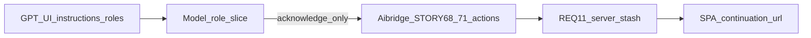

# REQ15 TG interviewer — roles UX residual (target tech-arch)

**Status:** Target · refreshed 2026-11-10T12:24:53Z (ROL-07) · prior 2026-11-06  
**Method:** [`.cursor/rules/analysis.mdc`](../../../../.cursor/rules/analysis.mdc)  
**Stories:** [STORY-GPT-ROL-05](../../tasks/backlog-stories/req15-tg-interviewer-roles-ux/STORY-GPT-ROL-05-channel-interview-stage-proactivity.md) · [STORY-GPT-ROL-06](../../tasks/backlog-stories/req15-tg-interviewer-roles-ux/STORY-GPT-ROL-06-channel-interview-surface-readability.md) · [STORY-GPT-ROL-07](../../tasks/backlog-stories/req15-tg-interviewer-roles-ux/STORY-GPT-ROL-07-citizen-surface-no-role-theater.md)  
**Package INDEX:** [`../../tasks/backlog-stories/req15-tg-interviewer-roles-ux/INDEX.md`](../../tasks/backlog-stories/req15-tg-interviewer-roles-ux/INDEX.md)

## Context & inputs

| Input | Role |
|-------|------|
| ROL-05 / ROL-06 | Proactivity + handoff wording / TG surface (**Done** Awaiting Commits — Keep) |
| ROL-07 | Citizen surface: no role theater ([03](./03-citizen-surface-no-role-theater.md)) |
| Peer [STORY-AIBRIDGE-68](../../../../doge-ai-bridge/docs/tasks/backlog-stories/req15-tg-channel-interviewer-ux/STORY-AIBRIDGE-68-channel-seam-send-actions-always.md) | Continue/edit/Send mint (Keep) |
| Peer [STORY-AIBRIDGE-71](../../../../doge-ai-bridge/docs/tasks/backlog-stories/req15-tg-channel-interviewer-ux/STORY-AIBRIDGE-71-awaiting-interpretation-actions-always.md) | Soft-dep ROL-07 — Confirm/Edit when awaiting interpretation |
| REQ-48 roles SSOT | [`instructions-roles/`](../../../instructions-roles/) — ROL-01…04 **Done**; do not reopen archive/export |
| Evidence | [triage](../../../../docs/analysis/req15-tg-interviewer-ux-gap-triage-2026-11-06.md) · [target UX](../../../../docs/analysis/req15-tg-interviewer-target-ux-2026-11-06.md) · [north star](../../../../docs/analysis/req15-tg-interviewer-citizen-conversation-north-star-2026-11-10.md) · [citizen gap](../../../../docs/analysis/req15-tg-interviewer-citizen-conversation-gap-2026-11-10.md) |

**Coexistence:** extends [`../req-48-role-oriented-instruction-line/00-overview.md`](../req-48-role-oriented-instruction-line/00-overview.md). This package = **residual channel UX** in instruction prose only.

## Trust boundaries

| Layer | Owns |
|-------|------|
| `instructions-roles` prose | Stage auto-advance; handoff **wording**; TG surface style; **citizen utterance covenant** (no role theater) |
| aibridge (68 / 71) | Mint continue / edit / Confirm / Send confirm **actions** |
| REQ-11 Keep | HTTPS stash; `continuation_url` after success |
| SPA + identity | Login / OTP / citizen submit after user opens URL |

**Forbidden in roles prose (citizen-facing):** model-owned `POST /story-drafts` / invent SPA URL or Bearer; bare «интерфейс» without controls; **role/pipeline theater** and fake progress ([03](./03-citizen-surface-no-role-theater.md)).

## Target flow (logical)

1. Roles instruct **proactive** stage advance when citizen data enough (ROL-05 → [01](./01-stage-proactivity-handoff.md)).  
2. At non-seamless seams, model **acknowledges**; server exposes actions (peer 68 / 71).  
3. Send-ready → Send confirm → server stash → `continuation_url` in TG.  
4. Citizen-facing turns follow **air + light markers** (ROL-06 → [02](./02-surface-readability.md)).  
5. Citizen hears a calm helper — **never** an internal ops console (ROL-07 → [03](./03-citizen-surface-no-role-theater.md)).

**Edit order:** **05 → 06** Done · residual **07** soft-parallel with aibridge 71/72 (do not co-edit same handoff lines blindly).

## Locked touch set (implement later)

| File | ROL-05 | ROL-06 | ROL-07 |
|------|--------|--------|--------|
| `instructions-roles/core.md` | primary | primary (style) | primary (citizen covenant) |
| `instructions-roles/interviewer.md` | primary | primary | primary (utterance) |
| `checker.md` / `normalizer.md` | handoff if needed | long walls only | fence line |
| `extractor.md` / `communication_setup.md` | OOS | OOS | fence line |
| Packs / archive | OOS | OOS | OOS |

## Verify surfaces

- Grep: stash/SPA invent strings still forbidden (ROL-03 strip).  
- Grep: no bare «интерфейс» as sole submit path.  
- Style: prefer markers over dense `**` spam; TG orange = Unicode honesty.  
- Grep / review: no citizen-facing HANDOFF / extractor / checker / «передал» / «следующий процесс» / command-school primary path ([03](./03-citizen-surface-no-role-theater.md)).

## As-is honesty

| Fact | Status |
|------|--------|
| Roles volume Present | `GPT-UI/instructions-roles/` |
| Stash strip in `core.md` | **Present** |
| ROL-05/06 Apply | **Done** (Awaiting Commits) — proactivity / readability Present |
| Citizen no-theater covenant | **Absent** / weak — live 2026-11-10 handoff-chain theater Observed |
| STORY-71 Confirm/Edit always | Soft-dep Peer Emitted — do not invent CTAs in prose |

## Not in this doc

- NEW STORY keys / pkg activate / P3 body patches.  
- Minting ChannelAction code (aibridge 71/72).  
- Language picker (STORY-69).  
- Export parity rematerialize.  
- Reopening ROL-05/06 AC.
