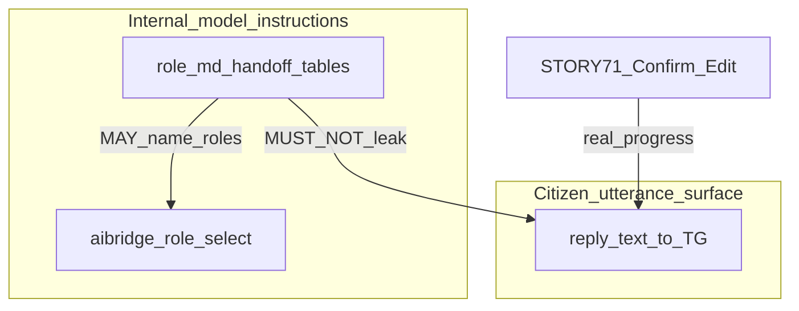

# Citizen surface: no role theater (ROL-07)

**Parent:** [00-overview.md](./00-overview.md)  
**Story:** [STORY-GPT-ROL-07](../../tasks/backlog-stories/req15-tg-interviewer-roles-ux/STORY-GPT-ROL-07-citizen-surface-no-role-theater.md)  
**As-of:** 2026-11-10T12:24:53Z  
**Evidence:** [north star](../../../../docs/analysis/req15-tg-interviewer-citizen-conversation-north-star-2026-11-10.md) §1–4 · [citizen gap](../../../../docs/analysis/req15-tg-interviewer-citizen-conversation-gap-2026-11-10.md) §4.1–4.4

## Dual-surface model

| Surface | Allowed | Forbidden |
|---------|---------|-----------|
| Instruction files (model-facing) | Role ids, chain order, handoff tables for assembly | N/A (methodology Keep) |
| Citizen `reply_text` | Calm draft talk; point to **Present** in-chat CTAs; honest «не могу выдумать статус/URL» | Operable jargon (extractor / checker / HANDOFF / «следующий процесс»); fake «передал»; free-text command school as **primary** path |

**Key split:** naming `extractor` inside `extractor.md` for the model is OK; telling the **citizen** to «передайте экстрактору» or claiming «HANDOFF выполнен» without server advance is **not**.

## Forbidden on citizen surface (normative)

1. Operable role / pipeline jargon as user steps (`extractor`, `checker`, `normalizer`, `HANDOFF`, «следующий процесс», equivalents).  
2. Claiming handoff / validation / send **completed** or material «передан» when server CTAs / confirm FSM did **not** advance.  
3. Coaching free-text («дальше», «валидируй», «отправляй», «запускай», «передай экстрактору») as the **primary** product path when in-chat server actions are the intended control.  
4. Model-owned stash / invent SPA URL / Bearer (ROL-03 Keep — still Present in `core.md`).

**MAY:** honestly refuse inventing status/number/URL; point to in-chat actions **when** those actions are the server path (peer [STORY-71](../../../../doge-ai-bridge/docs/tasks/backlog-stories/req15-tg-channel-interviewer-ux/STORY-AIBRIDGE-71-awaiting-interpretation-actions-always.md) / 72).

## Ownership vs peer STORY-71

| Concern | GPT UI (ROL-07) | aibridge 71 |
|---------|-----------------|-------------|
| Ban role theater in `reply_text` | Yes | No (runtime) |
| Mint Confirm/Edit when FSM awaiting interpretation | No | Yes |
| Empty actions → theater substitute | **Forbidden** | Fix mint (71) |
| Invent action schemas in roles prose | **Forbidden** | Server owns schemas |

Soft-dep: do **not** promise CTAs the server will not mint; if actions empty — wait/refuse honestly, never theater.

## Touch set (Apply later)

| File | Duty |
|------|------|
| `instructions-roles/core.md` | **Citizen surface covenant** (primary) |
| `instructions-roles/interviewer.md` | Utterance rules for draft talk (primary) |
| `extractor.md` / `checker.md` / `normalizer.md` / `communication_setup.md` | One-line fence: handoff tables = internal; citizen-visible text follows core |
| Packs / archive / ROL-01…04 reopen | OOS |

## Verify / grep (implement gate)

Citizen-facing anti-patterns (instruction guidance + sample review):

- `HANDOFF`, «экстрактор» / «чекер» / «нормализатор» as **user** steps  
- «передал», «следующий процесс»  
- Coaching «валидируй» / «запускай» / «передай» as primary path  
- Stash invent / SPA URL invent still banned (ROL-03)

AC: AC-ROL-07-01…04.

## Out of scope

- Minting ChannelAction code (71/72).  
- Surface air/emoji (ROL-06 Keep).  
- Premature Send sequencing ownership (aibridge 72 — cite only).  
- Applying instruction bodies in this arch wave (name≠create until Apply).
