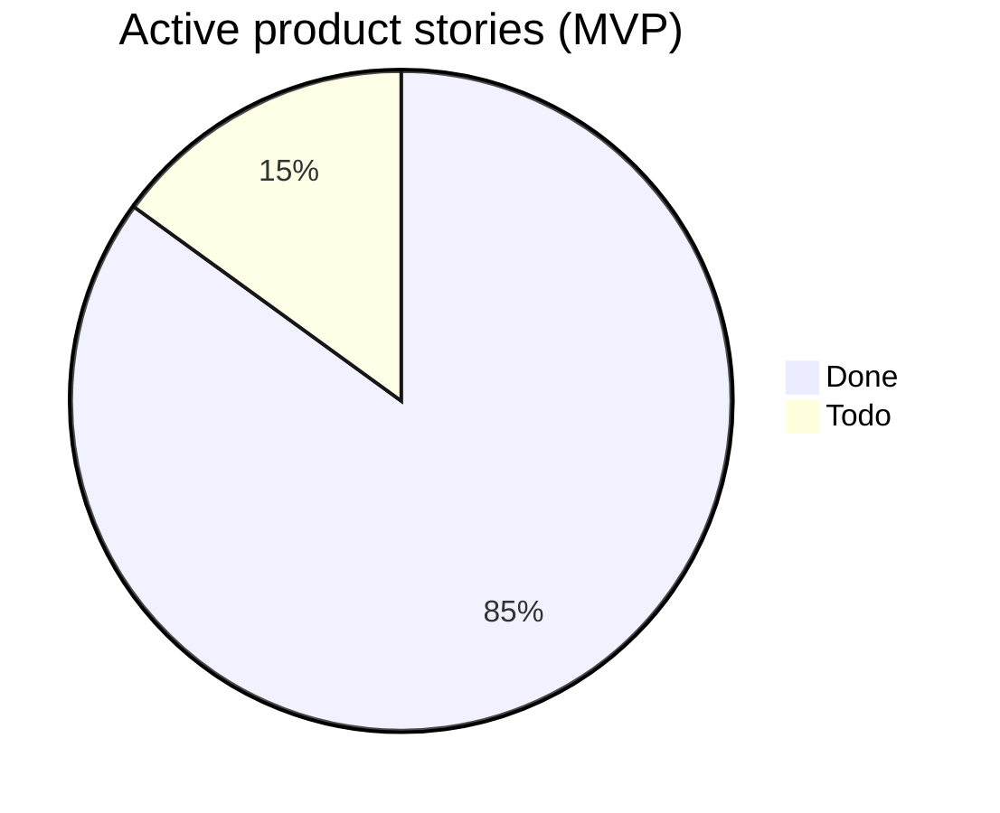

# GPT · scope dashboard

> **Scope-Id:** mvp  
> **Scope:** MVP  
> **SSOT:** package [`INDEX.md`](backlog-stories/INDEX.md) · [module1 tasks index](../analysis/tasks/gpt-interview-module1-tasks-index.md) · [requirements/](../requirements/) (Status) · [`epics/`](../analysis/tasks/epics/)  
> **Updated:** 2026-11-02T12:40:40Z  
> **Last change:** Materialize REQ-48 package `req-48-role-oriented-instruction-line` (GPT-ROL-01…04 Todo); recount product stories from disk.

## Summary

| Metric | Value |
|--------|-------|
| Backlog packages | 6 |
| Active product stories | 40 |
| Done (product) | 34 |
| Todo (product) | 6 |
| Deferred | 1 (REQ-21) |
| **Overall progress (product active)** | **85%** `██████████░░` |

*Product recount 2026-11-02: Cancelled GPT-SSR-15 excluded. Todo = GPT-SSR-16, GPT-SSR-18, GPT-ROL-01…04. REQ Draft/Open (REQ-44/45a/46/48) tracked in Remaining — not mixed into product % this refresh. Module 1 epics Done вне denominator. Doc-tasks: 0.*

## By package

| Package | Stories | Done | Todo | Deferred | Progress |
|---------|---------|------|------|----------|----------|
| [story-submit-handoff](backlog-stories/story-submit-handoff/INDEX.md) | 2 | 2 | 0 | 0 | 100% `████████████` |
| [taxonomy-contract](backlog-stories/taxonomy-contract/INDEX.md) | 1 | 1 | 0 | 0 | 100% `████████████` |
| [intake-hardening](backlog-stories/intake-hardening/INDEX.md) | 4 | 4 | 0 | 0 | 100% `████████████` |
| [semantic-schema-runtime](backlog-stories/semantic-schema-runtime/INDEX.md) | 16 active | 14 | 2 | 0 | 88% `███████████░` |
| [node-onboarding](backlog-stories/node-onboarding/INDEX.md) | 13 | 13 | 0 | 0 | 100% `████████████` |
| [req-48-role-oriented-instruction-line](backlog-stories/req-48-role-oriented-instruction-line/INDEX.md) | 4 | 0 | 4 | 0 | 0% `░░░░░░░░░░░░` |

## Remaining

| Type | Key | Title | Package/Epic | Status | Priority | Essence |
|------|-----|-------|--------------|--------|----------|---------|
| story | [GPT-ROL-01](backlog-stories/req-48-role-oriented-instruction-line/STORY-GPT-ROL-01-archive-module1-snapshot.md) | Archive Module-1 snapshot | req-48-role-oriented-instruction-line | Todo | P1 | AC-04 first; path `instructions-archive-module1-req48/` |
| story | [GPT-ROL-02](backlog-stories/req-48-role-oriented-instruction-line/STORY-GPT-ROL-02-module1-role-mapping.md) | Module-1 → role mapping | req-48-role-oriented-instruction-line | Todo | P1 | AC-01; depends ROL-01 |
| story | [GPT-ROL-03](backlog-stories/req-48-role-oriented-instruction-line/STORY-GPT-ROL-03-author-roles-line-strip-stash.md) | Author roles line + strip stash | req-48-role-oriented-instruction-line | Todo | P1 | AC-02/03; sibling `instructions-roles/` |
| story | [GPT-ROL-04](backlog-stories/req-48-role-oriented-instruction-line/STORY-GPT-ROL-04-export-roles-schema-parity-ops.md) | Export roles-schema + parity + ops | req-48-role-oriented-instruction-line | Todo | P1 | AC-05…07; V2/E1 |
| story | [GPT-SSR-16](backlog-stories/semantic-schema-runtime/STORY-GPT-SSR-16-meta-optional-symmetry-and-checklist-gates.md) | Meta optional symmetry + checklist | semantic-schema-runtime | Todo | P1 | Wave 5 |
| story | [GPT-SSR-18](backlog-stories/semantic-schema-runtime/STORY-GPT-SSR-18-core-pack-portability-strip-node-specific.md) | Core vs pack portability | semantic-schema-runtime | Todo | P0 | Strip node-specific from shared Module-1 |
| req | [REQ-48](../requirements/REQ-48-req15-role-oriented-instruction-line-and-export.md) | Role-oriented instruction line + export | requirements / REQ15 | Draft | P1 | Parent of GPT-ROL-01…04 · tech-arch Present |
| req | [REQ-45a](../requirements/REQ-45a-pack-prose-identities-and-flat-layout.md) | Pack prose identities + flat layout | requirements / SSR | Draft | P1 | Parent of SSR flat wave |
| req | [REQ-46](../requirements/REQ-46-pack-builder-prompt-wrapper-and-repair-debug.md) | Pack Builder wrapper + repair | requirements / node-onboarding | Draft | P1 | Parent of GPT-PB |
| req | [REQ-44](../requirements/REQ-44-research-program-framework.md) | Research Program Framework | requirements / post-product | Open | P2 | Когда продукт берёт research в scope |

## Requirements Done

| REQ | Title | Evidence |
|-----|-------|----------|
| [REQ-45](../requirements/REQ-45-semantic-schema-intake-envelope-compatibility.md) | Semantic Schema — GPT core vs pack | Accepted — GPT-SSR-01…10 Done (SSR-10 taxonomy SSOT retire pkg-000047) |
| [REQ-18](../requirements/REQ-18-api-inbound-story-intake-and-gpt-handoff.md) | Handoff GPT → API (Story Intake) | Done (superseded details) — REQ-22 + SUBMIT-01/02 |
| [REQ-19](../requirements/REQ-19-security-auth-boundaries-and-user-identity-flow.md) | Security boundaries | Done — GIM-57; §3 superseded by SUBMIT-01 |
| [REQ-20](../requirements/REQ-20-label-taxonomy-and-extraction-axes.md) | Label taxonomy / axes | Done — EPIC-M1-08 + GPT-TAX-01 |
| [REQ-22](../requirements/REQ-22-story-intake-wire-contract-v2-alignment.md) | Story Intake Wire Contract v2 | Done — EPIC-M1-09 |
| [REQ-23](../requirements/REQ-23-gpt-behavioral-extensions-pii-signals-consistency.md) | Behavioral extensions (PII, signals) | Done — EPIC-M1-10 (flags; **weaker than** GPT-PII-01 target) |
| [REQ-24](../requirements/REQ-24-gpt-orchestrator-response-contract-corrections.md) | Orchestrator response contract | Done — EPIC-M1-09 |
| [REQ-25](../requirements/REQ-25-canonical-type-labels-and-summary-wire-activation.md) | canonical_type / labels wire | Done — EPIC-M1-09 |
| [REQ-26](../requirements/REQ-26-location-query-normalizer-to-wire.md) | location_query → wire | Done — EPIC-M1-09 |
| [REQ-27](../requirements/REQ-27-gpt-signals-enum-sync-and-data-model-update.md) | gpt_signals enum sync | Done — EPIC-M1-10 |
| [REQ-28](../requirements/REQ-28-institution-demo-constraint-gate.md) | institution demo gate | Done — EPIC-M1-10 |
| [REQ-29](../requirements/REQ-29-phase7-translation-review.md) | Phase 7 translation gate | Done — EPIC-M1-02 |
| [REQ-30](../requirements/REQ-30-admission-gate-story-intake-strict-chain.md) | Admission gate strict-chain | Done — EPIC-M1-06 (GPT; §2.4 server → GPT-GUARD-01) |
| [REQ-31](../requirements/REQ-31-God-mode-activation.md) | Citizen / God mode UX | Done — EPIC-M1-06 |
| [REQ-32](../requirements/REQ-32-origin-traceability-sending-enforcement.md) | origin.source enforcement | Done — EPIC-M1-06 |
| [REQ-33](../requirements/REQ-33-label-extraction-multi-axis-improvement.md) | Multi-axis label extraction | Done — EPIC-M1-08 / GIM-145…146 |
| [REQ-34](../requirements/REQ-34-summary-generation-and-canonical-type-clarity.md) | Summary generation | Done — pkg-000015 |
| [REQ-35](../requirements/REQ-35-demo-field-population-gpt-fixes.md) | Demo field-population | Done — pkg-000016 |
| [REQ-36](../requirements/REQ-36-civic-taxonomy-expansion-multi-axis.md) | Civic taxonomy expansion | Done — pkg-000017 |
| [REQ-38](../requirements/REQ-38-ecosystem-deficit-story-detection.md) | Ecosystem-deficit detection | Done — pkg-000018 + GIM-166 |
| [REQ-39](../requirements/REQ-39-geographic-intelligence-confidence-canonicalization.md) | Geographic intelligence | Done — pkg-000019 |
| [REQ-40](../requirements/REQ-40-pre-submission-instruction-compliance-validation.md) | Pre-submission compliance | Done — pkg-000020 |
| [REQ-41](../requirements/REQ-41-trigger-observability-audit-trail.md) | Trigger observability | Done — pkg-000021 · EPIC-M1-06 |
| [REQ-42](../requirements/REQ-42-adaptive-post-submission-confirmation-message.md) | Adaptive post-submit message | Done — pkg-000022 · EPIC-M1-06 |
| [REQ-43](../requirements/REQ-43-proactive-story-intake-offer.md) | Proactive story-intake offer | Done — pkg-000023 · EPIC-M1-02 |

**Count Done:** 25 · Baseline SoT REQ-01…17 — не в active % (foundation draft).

## Epic rollup

| Epic | Status | Notes |
|------|--------|-------|
| [EPIC-M1-01](../analysis/tasks/epics/EPIC-M1-01-issue-domain-instruction-foundation/EPIC-M1-01-issue-domain-instruction-foundation.md) | Done | 6 stories — instruction foundation |
| [EPIC-M1-02](../analysis/tasks/epics/EPIC-M1-02-interview-dialogue-experience/EPIC-M1-02-interview-dialogue-experience.md) | Done | 11 stories — interview / REQ-29/43 |
| [EPIC-M1-03](../analysis/tasks/epics/EPIC-M1-03-FR-M1-traceability-and-ingest-core/EPIC-M1-03-FR-M1-traceability-and-ingest-core.md) | Done | 6 stories — FR-M1 / ingest |
| [EPIC-M1-04](../analysis/tasks/epics/EPIC-M1-04-policy-gate-operator-rulebook/EPIC-M1-04-policy-gate-operator-rulebook.md) | Done | 4 stories — policy gate |
| [EPIC-M1-05](../analysis/tasks/epics/EPIC-M1-05-issue-normalizer-strict-codes/EPIC-M1-05-issue-normalizer-strict-codes.md) | Done | 13 stories — normalizer / REQ-34/35/39 |
| [EPIC-M1-06](../analysis/tasks/epics/EPIC-M1-06-orchestrator-openapi-web2/EPIC-M1-06-orchestrator-openapi-web2.md) | Done | 26 stories — orchestrator / SUBMIT |
| [EPIC-M1-07](../analysis/tasks/epics/EPIC-M1-07-acceptance-SPA-SoT/EPIC-M1-07-acceptance-SPA-SoT.md) | Done | 3 stories — acceptance / SoT |
| [EPIC-M1-08](../analysis/tasks/epics/EPIC-M1-08-label-extraction-axes-controlled-vocabulary/EPIC-M1-08-label-extraction-axes-controlled-vocabulary.md) | Done | 19 stories — taxonomy / GPT-TAX-01 |
| [EPIC-M1-09](../analysis/tasks/epics/EPIC-M1-09-req22-wire-contract-v2-alignment/EPIC-M1-09-req22-wire-contract-v2-alignment.md) | Done | 17 stories — wire v2 / REQ-22…26 |
| [EPIC-M1-10](../analysis/tasks/epics/EPIC-M1-10-req23-behavioral-extensions/EPIC-M1-10-req23-behavioral-extensions.md) | Done | 12 stories — REQ-23/27/28 |

Полные списки stories — в epic folders / [module1 index](../analysis/tasks/gpt-interview-module1-tasks-index.md).

### Product stories Done

| Key | Evidence |
|-----|----------|
| [GPT-SUBMIT-01](backlog-stories/story-submit-handoff/STORY-GPT-SUBMIT-01-redirect-handoff.md) | Done · pkg-000024+025 · M1-06-25 |
| [GPT-SUBMIT-02](backlog-stories/story-submit-handoff/STORY-GPT-SUBMIT-02-legacy-intake-submitter-cleanup.md) | Done · pkg-000026 · M1-06-26 |
| [GPT-TAX-01](backlog-stories/taxonomy-contract/STORY-GPT-TAX-01-per-axis-taxonomy-contract.md) | Done · pkg-000027 · GM8-19 · OpenAPI 0.7.0 |
| [GPT-MISSION-01](backlog-stories/intake-hardening/STORY-GPT-MISSION-01-mission-aligned-content-cleanliness.md) | Done · pkg-000029 · EPIC-M1-04 |
| [GPT-TAX-02](backlog-stories/intake-hardening/STORY-GPT-TAX-02-taxonomy-label-key-sync.md) | Done · pkg-000033 · EPIC-M1-08 |
| [GPT-GUARD-01](backlog-stories/intake-hardening/STORY-GPT-GUARD-01-zero-junk-throughput.md) | Done · pkg-000034 · EPIC-M1-06 |
| [GPT-PII-01](backlog-stories/intake-hardening/STORY-GPT-PII-01-zero-pii-on-wire.md) | Done · pkg-000035 · EPIC-M1-10 |
| [GPT-SSR-04](backlog-stories/semantic-schema-runtime/STORY-GPT-SSR-04-literal-gateway-json-copy-paste.md) | Done · pkg-000040 · EPIC-M1-01 · G-FMT-01 layout lock |
| [GPT-SSR-05](backlog-stories/semantic-schema-runtime/STORY-GPT-SSR-05-taxonomy-json-pack-copy-paste.md) | Done · pkg-000041 · EPIC-M1-01 · G-TAX-01 taxonomy JSON copy-paste |
| [GPT-SSR-06](backlog-stories/semantic-schema-runtime/STORY-GPT-SSR-06-inbound-validation-post-ssr-delta.md) | Done · pkg-000043 · EPIC-M1-01 · inbound v1.3 dual-contour delta |
| [GPT-SSR-10](backlog-stories/semantic-schema-runtime/STORY-GPT-SSR-10-core-taxonomy-ssot-retire-md.md) | Done · pkg-000047 · EPIC-M1-01 · taxonomy SSOT retire MD |

## Roadmap → 100%

**Текущая точка (product):** **34/40 (85%)**. Open product Todo: **GPT-ROL-01…04**, **GPT-SSR-16**, **GPT-SSR-18**. Module 1 **10/10 epics**.

| Цель | Знаменатель | Как закрыть |
|------|-------------|-------------|
| **Product 100%** | 40 | + GPT-ROL-01→04 + GPT-SSR-16 + GPT-SSR-18 |
| **Полные 100%** | + REQ-21 Deferred | post-demo privacy / vault (≠ GPT-PII-01 wire) |

## §Now

1. **req-48-role-oriented-instruction-line** — **GPT-ROL-01 → 02 → 03 → 04** (REQ-48; archive first).
2. **semantic-schema-runtime** — remaining Todo **GPT-SSR-16**, **GPT-SSR-18**.
3. **REQ-48** Draft + tech-arch Present — stories materialized; optional PA.3 refine before P1.3.
4. **REQ-44 / 45a / 46** — Draft/Open residual (not blocking ROL chain).

## §Deferred

- [REQ-21](../requirements/REQ-21-post-demo-privacy-pii-and-web3-vault-policy.md) — post-demo privacy / PII / vault (Deferred). Не смешивать с GPT-PII-01 (zero PII on wire).
- REQ-37 vacant (слот → REQ-40/41; файла нет) — не work item.

## Mermaid — completion

## How to refresh

1. Product counts — package `INDEX.md` + [backlog-stories/INDEX.md](backlog-stories/INDEX.md).
2. REQ — поле Status в `requirements/REQ-*.md`.
3. Epic Status — Meta в `epics/**` / [module1 §1](../analysis/tasks/gpt-interview-module1-tasks-index.md).
4. Канон: [`backlog-dashboard-template.md`](../../../docs/methodology/Zeya888-builder-queue/workflow/backlog-dashboard-template.md).
5. `npm run dashboard:aggregate`
6. Focus prompt: [`build-scope-dashboard-prompt.md`](../../../docs/methodology/Zeya888-builder-queue/workflow/build-scope-dashboard-prompt.md)
